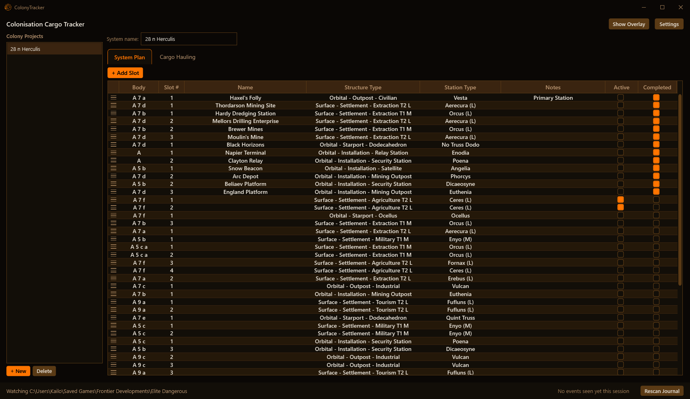
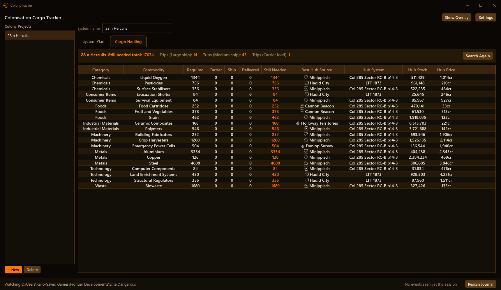
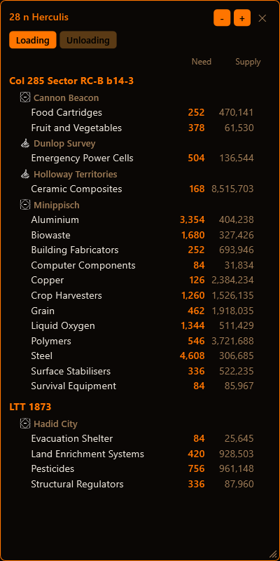
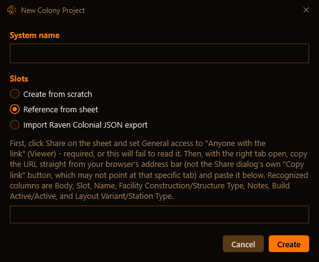
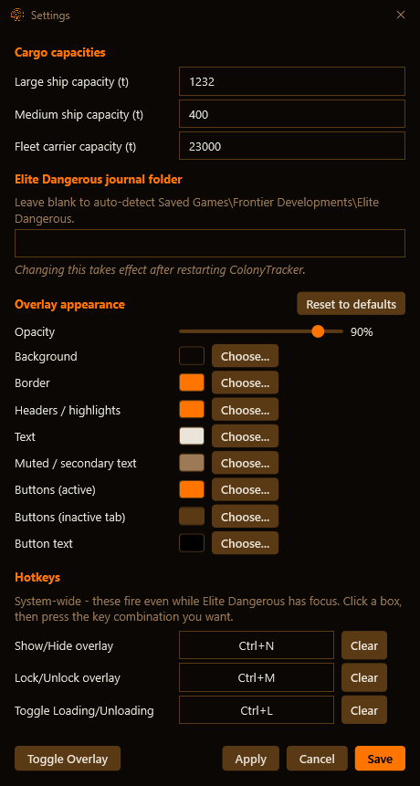

# Elite Dangerous Colonisation Tracker

A Windows desktop tool for **Elite Dangerous** colonisation. Plan the structures in your systems, see exactly which commodities every build still needs, and watch the numbers count down live as you haul.

---

### What it does:
The app has two tabs and an in-game overlay:

- **System Plan:** Lay out each colony system body by body: which slot gets which structure, which builds are active right now, and which are finished. The full build-cost catalogue is built in, including the higher-cost primary versions of each station. Start a new project from scratch, or import a system you've already planned (see [Importing a system](#importing-a-system) below).

  Tick **Active** on the sites you're building. When a site's own progress report shows nothing left to deliver, EDCT ticks **Completed** for you (the game writes that report while you're docked at the site, and the slot's Name has to match the site's name). Completed sites drop out of Cargo Hauling and the overlay, and stay in your plan as a record. Untick Completed to bring a site back.

  

- **Cargo Hauling:** One list of every commodity your active, unfinished builds need, with how much is required, delivered, on your ship, on your fleet carrier, and still needed. The delivered, ship and carrier figures update by themselves from the game:
  - what the construction site has received, from the game's own depot reports
  - what's in your hold, from the game's cargo file
  - what you move to and from your own carrier, from your transfers

  It also works out how many trips are left at your ship's and your carrier's capacity, and shows which of your hub stations currently has the best stock of each commodity, so you know where to load next.

  

- **Overlay:** A small see-through window that sits on top of the game and shows only what's still needed, or where you're unloading. Lock it so clicks go straight through to the game, set its colours and transparency, and use your own hotkeys to show or hide it, lock it, or switch between Loading and Unloading while you play (see [Settings](#settings) below).

  

If the numbers ever look off, **Rescan Journal** reads the current session's journal again from the start.

### Importing a system:
New Project has three ways in: **Create from scratch**, **Reference from sheet** and **Import Raven Colonial JSON export**.

**From your own copy of DaftMav's sheet.** The sheet import is built around DaftMav's community planning sheet (Colonization Construction v3), so **it has to be your own copy of that sheet**. Other planning sheets lay their columns out differently and won't be read correctly.
1. Make your own copy of DaftMav's sheet with [this "make a copy" link](https://docs.google.com/spreadsheets/d/1jsZOzNJSnPIWlU88puOc9gQXvsw-MGp8meoQ6k-Yj-Y/copy?usp=sharing) (from his [Frontier forums post](https://forums.frontier.co.uk/threads/v3-of-the-colonization-construction-spreadsheet-is-now-available.635762/)), then plan the system on its tab.
2. Click **Share** and set General access to **Anyone with the link** (Viewer). EDCT can't read the sheet otherwise.
3. Open the system's tab and copy the URL from your browser's address bar. Don't use the Share dialog's **Copy link** button, because that link may not point at the tab you want.
4. In EDCT, choose **New Project**, pick **Reference from sheet** and paste the link. If you leave the system name blank, it's taken from the sheet (cell D1).

**From Raven Colonial.** Export a backup of the system from [ravencolonial.com](https://ravencolonial.com), pick **Import Raven Colonial JSON export**, then browse for the file or paste its contents. The system name and body labels come from the file.

### Settings:
Open **Settings** at the top right of the main window.

- **Cargo capacities:** your large ship, medium ship and fleet carrier capacity in tonnes. Cargo Hauling uses these to work out how many trips are left.
- **Elite Dangerous journal folder:** leave it blank and EDCT finds the game's journal by itself. Only fill it in if your journal lives somewhere else. A change here takes effect after you restart EDCT.
- **Overlay appearance:** each of the overlay's eight colours (background, border, headers and highlights, text, muted text, active buttons, inactive tab buttons and button text) has a **Choose...** button that opens a colour picker with a hex box and red, green and blue sliders. **Opacity** fades only the background, so text stays sharp over the game. **Reset to defaults** puts the original look back.
- **Hotkeys:** three system-wide shortcuts that work while Elite Dangerous has focus: **Show/Hide overlay**, **Lock/Unlock overlay** (click-through on or off) and **Toggle Loading/Unloading**. Click a box and press the key combination you want, or press Escape to cancel. **Clear** removes a shortcut. If another program already uses that combination, EDCT tells you straight away instead of failing silently later.
- **Trying changes out:** **Apply** updates the overlay live without closing Settings, and **Toggle Overlay** shows or hides it from here, so you can tune the colours with the overlay in view. **Save** keeps everything and closes. **Cancel** closes without saving anything you haven't already applied.

### Where the data comes from:
- **Build costs** come from DaftMav's community colonisation planning sheet ([Colonization Construction v3](https://forums.frontier.co.uk/threads/v3-of-the-colonization-construction-spreadsheet-is-now-available.635762/)) and SrvSurvey's colonisation cost data.
- **Your progress** comes from your own game journal and cargo file, read on your PC.
- **Hub station stock** comes from the same EDDN-fed relay that EDCF uses. Please run a journal reporting tool such as [EDDiscovery](https://github.com/EDDiscovery/EDDiscovery) or [EDMarketConnector](https://github.com/EDCD/EDMarketConnector) to help keep that data fresh for everyone.

### Requirements:
- **Windows 10 or 11.** It doesn't run on macOS or Linux.
- **Elite Dangerous** on the same PC. The journal folder is found automatically.
- Internet access for the hub station prices and sheet imports. Everything else works offline.

### Installing:
Run `ColonyTracker.exe` with the `Data` folder next to it. Your projects and settings are saved in that same folder. There's no installer and nothing else to set up, it's a single self-contained program.

### Known limitations:
- Transfers to and from a squadron carrier can't be tracked automatically, because the game doesn't write them to the journal. Only your own carrier is tracked.
- Carrier stock picked up from your transfers is saved when the app closes normally. If it crashes, that session's transfers are lost.

---

### Disclaimer

EDCT is an independent, unofficial project and is not affiliated with, endorsed by, or sponsored by Frontier Developments plc. Elite Dangerous and all related trademarks are the property of Frontier Developments plc.

This software is provided "as is," without warranty of any kind, express or implied. Use at your own risk.
